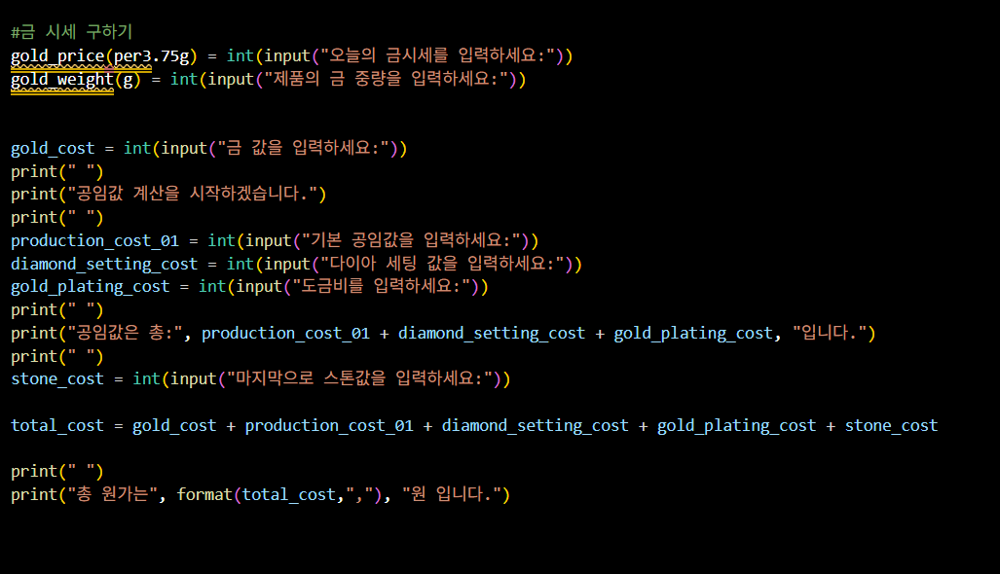
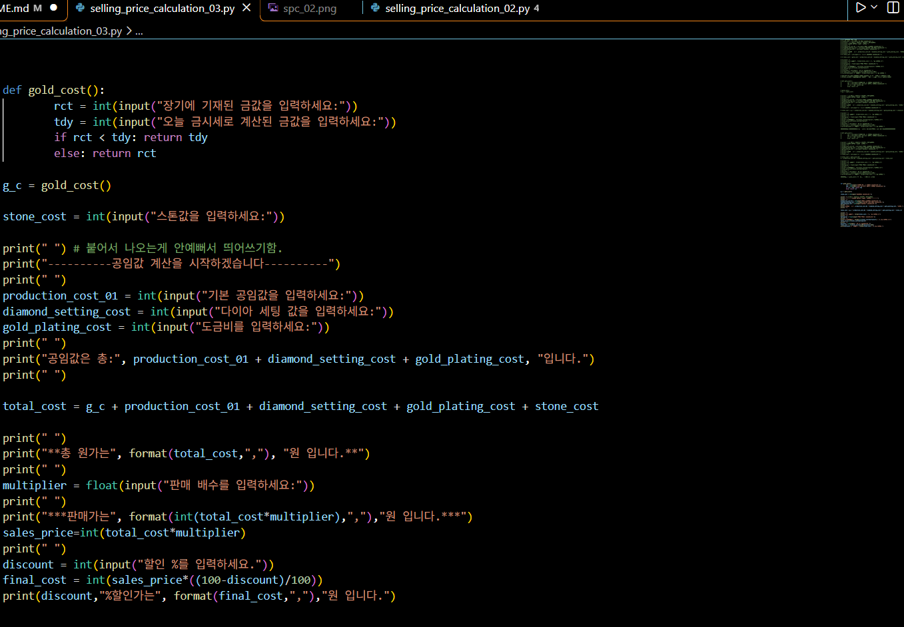
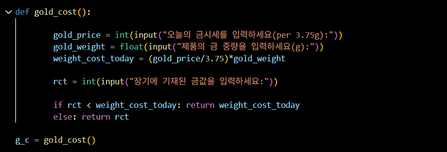
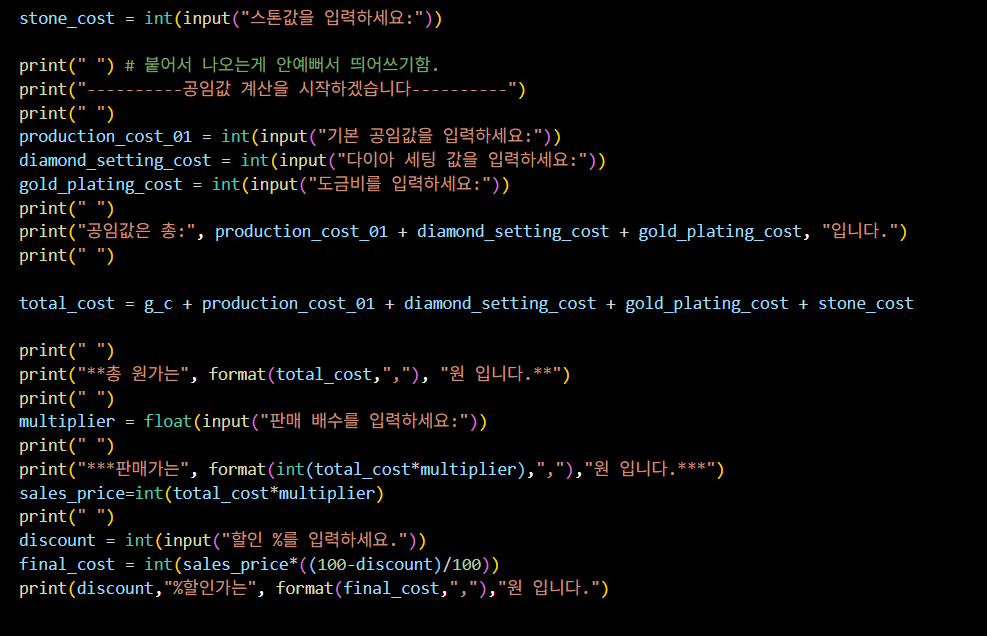
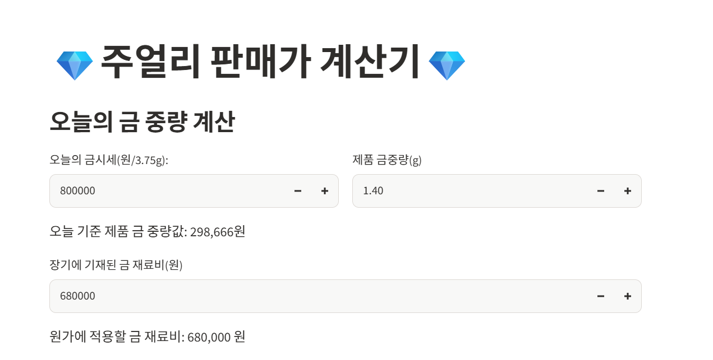
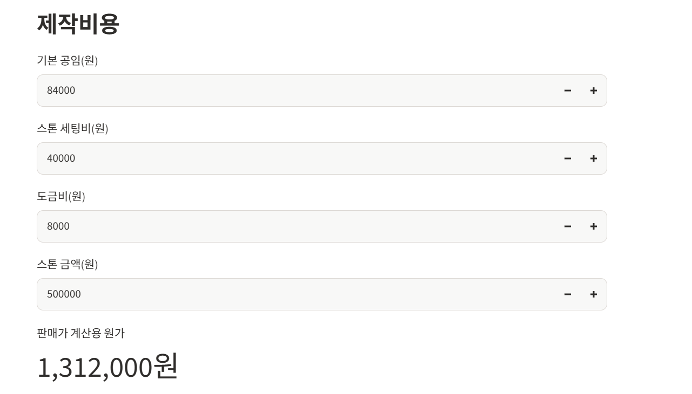
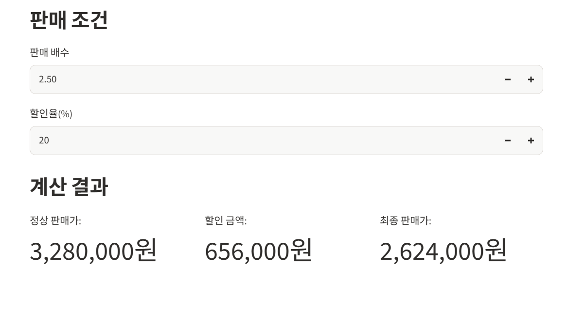

# 💎 Jewelry Selling Price Calculator💎

### 직접 만들어본 주얼리 계산기~_~

Python과 Streamlit을 활용한 주얼리 견적 및 판매가 계산 프로젝트!

**개발 시작: 2026년 11월 | 개인 학습 프로젝트**

## 1. 프로젝트를 시작한 이유

주얼리 디자이너로 일하면서 번거로운 견적 계산과 반복적인 가격 수정 업무를 경험했음

특히 금 시세가 급등 혹은 급락했을 때 수많은 상품의 판매가를 수정하는 데 3~4일을 꼬박 씀.
이 단순한 업무를 왜!! 내가 해야하는가!! 안그래도 바빠죽겠는데!!!

종로 공장에는 아직도 수기로 작성해서 보관하는 곳이 꽤 있음.. 엑셀도 쓰시긴함. 근데 더 직관적으로 함수까지 착하게 포함되어있는 오직 주얼리 계산기를 만들어보고싶었고, 엑셀조차 힘겨운 주얼리쪽 소상공인분들을 위해 자연어 명령이 가능한 서비스도 만들면 너무너무 좋겠다고 생각함.  
종로 공장 사장님들을 위해 프로젝트 도!!전!!

우선 나는 코딩초보이기때문에 간단한 코딩으로 계산기를 만들어봄.

## 2. 개발 과정

10일 동안 파이썬 기초책 한번 쫙 읽고 만들어 본 계산기.

처음엔 깃도 몰라서 초반버전, 두번째버전, 세번째버전, 마지막버전 이렇게 따로따로 저장함; 
이제는 커밋 메시지를 알게 되었기 때문에 앞으로는 그렇게 저장할 예정!! 

1. ⬇️첫번째 파일: 아주 심플하게 접근해봄. 당장 필요한 변수들과 이 변수들의 합이 나오게끔.!

2. ⬇️두번째 파일: 두번째에는 대화형으로 input 함수를 사용해서 사용자가 직접 값을 입력하게 만들어봄. 
지금보니 더 깔끔하게 만들 수 있을 것 같은데, 파이널 파일(selling_price_calculation_04)에서 수정해볼 예정.

3. ⬇️세번째 파일: 실제 주얼리 계산할때 꼭 필요한 배수치기와 할인가 반영 기능을 추가함! 오른쪽 윗부분을 보면 알겠지만 배수와 할인 함수 관련 주석처리된 시행착오들이 있음. 내 시행착오를 지우기 싫어서 그냥 다 주석처리 하면서 수정함. 

4. ⬇️네번째 파일: 이번엔 실시간 금시세를 반영해야하는 상황을 고려해서 금값 계산하는 함수를 넣음. 이부분은 나중에 자동으로 실시간 금값이 업데이트되게끔 만들어보고 싶음.

5. ⬇️마지막으로 웹 페이지를 만들어 봄: gpt한테 물어보며 Streamlit이라는걸 이용해 만들어봤는데 매우 허접하지만 꽤나 맘에 듦.
    들어가보기 => [주얼리 판매가 계산기 열기](https://jewelrysellingpricecalculator-kpqhjk8hsxqjvdkthpv3yo.streamlit.app/)

이 코드들이 어떻게 컴퓨터 화면으로 출력이 되는지, 직접 원하는 곳에 숫자를 입력해서 값 도출해내는 페이지가 필요한데 이걸 어떻게 만드는건지 전혀 아예 아무 아이디어가 없는 상태에서 지피티한테 물어보고 스트림릿이라는게 있다라는걸 처음 듣고 시키는대로 만들어 봄. 너무 신기함.;;

---------------------------------------------------------------------------

## 3. 현재 구현한 기능

- 금 재료비 입력 및 비교
- 금 시세(3.75g 기준)와 제품 중량을 이용한 금 재료비 계산
- 기본 공임, 스톤 세팅비, 도금비, 스톤 금액 합산
- 판매 배수 적용
- 할인율에 따른 최종 판매가 계산
- Streamlit을 활용한 웹페이지 형태의 계산기

## 4. 프로젝트 파일 구성

| 파일명 | 설명 |
|---|---|
| `selling_price_calculation.py` | 초기 파이썬 계산기; 완전 심플 |
| `selling_price_calculation_02.py` | 계산 기능을 확장하며 작성한 실험 코드 |
| `selling_price_calculation_03.py` | 조건문과 금값 비교 등을 연습한 코드 |
| `selling_price_calculation_04.py` | 최근 작성한 터미널 기반 계산기 |
| `app.py` | Streamlit 판매가 계산기 |
| `app_gold.py` | 금 시세·중량 계산 기능을 추가한 Streamlit 웹페이지 |

## 5. 사용 기술

- **Python** — 가격 계산 로직 구현
- **Streamlit** — 웹 기반 사용자 인터페이스 제작
- **Git / GitHub** — 코드 및 변경 이력 관리
- **VS Code** — 개발 환경

## 6. 앞으로 구현하고 싶은 기능

1. 금 시세 자동 연동

앞에서도 얘기했듯 현재는 금값을 직접 입력해야함. 

이 번거로운 단계를 없애고자 실시간 금값시세가 자동으로 연동되는 기능을 넣고싶음.

2. 자연어 기반 AI 견적 계산

컴퓨터 사용이 번거로운 유저들을 위해 자연어 기반으로 가격을 산출하는 방식을 도입하고 싶음.

생성형 AI가 요청 내용을 해석하고, 파이썬 계산 로직이 빠르게 가격을 산출하는 방식이 목표.

3. 상품 가격 일괄 수정

금값이 변동하거나 그 외 사정으로 상품 가격을 일괄 변경해야할 때, 

한번에 계산 가능하고 쇼핑몰과 연동되어 모든 가격이 자동으로 수정되는 시스템 

+ 모든 제품이 등록되어 있어서 자유롭게 자연어로 명령 가능하게끔 발전 시켜보고픔.

## 7. 이 프로젝트를 통해 배우고 싶은 것

어디까지 내 시간을 아낄 수 있을지 도전.
