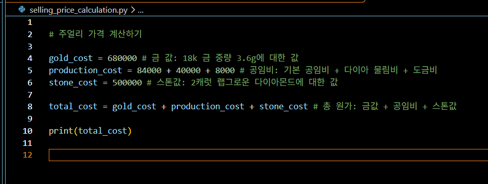

# 💎 Jewelry Selling Price Calculator💎

### 직접 만들어본 주얼리 계산기~_~

Python과 Streamlit을 활용한 주얼리 견적 및 판매가 계산 프로젝트!

**개발 시작: 2026년 11월 | 개인 학습 프로젝트**

## 1. 프로젝트를 시작한 이유

주얼리 디자이너로 일하면서 번거로운 견적 계산과 반복적인 가격 수정 업무를 경험했음

특히 금 시세가 급등 혹은 급락했을 때 수많은 상품의 판매가를 수정하는 데 3~4일을 꼬박 씀.
이 단순한 업무를 왜!! 내가 해야하는가!! 안그래도 바빠죽겠는데!!!

종로 공장에는 아직도 수기로 작성해서 보관하는 곳이 꽤 있음.. 엑셀도 쓰시긴함. 근데 더 직관적으로 함수까지 착하게 포함되어있는 오직 주얼리 계산기를 만들어보고싶었고, 엑셀조차 힘겨운 주얼리쪽 소상공인분들을 위해 자연어 명령이 가능한 서비스도 만들면 너무너무 좋겠다고 생각함.  
종로 공장 사장님들을 위해 프로젝트 도!!전!!

우선 나는 코딩초보이기때문에 간단한 코딩으로 계산기를 만들어봄.

## 2. 개발 과정

10일 동안 파이썬 기초책 한번 쫙 읽고 만들어 본 계산기.

처음엔 깃도 몰라서 초반버전, 두번째버전, 세번째버전, 마지막버전 이렇게 따로따로 저장함; 

이제는 커밋 메시지를 알게 되었기 때문에 앞으로는 그렇게 저장할 예정!! 

1.첫번째 파일: 아주 심플하게 접근해봄. 당장 필요한 변수들과 이 변수들의 합이 나오게끔.!

2.두번째 파일: 두번째에는 대화형으로 input 함수를 사용해서 사용자가 직접 값을 입력하게 만들어봄. 
            지금보니 더 깔끔하게 만들 수 있을 것 같은데, 내 파이널 파일에서 수정해볼 예정.

처음에는 터미널에서 숫자를 입력하고 계산 결과를 출력하는 간단한 프로그램으로 시작했습니다.

이후 실제 주얼리 판매가 산정 방식에 맞춰 금 재료비, 공임, 스톤 비용, 판매 배수, 할인율 등을 하나씩 추가했습니다.

처음에는 Git을 몰라 새로운 기능을 만들 때마다 파일을 따로 저장하며 이전 코드를 보존했습니다.

이후 Git과 GitHub를 배우면서 버전 관리의 필요성을 알게 되었고, 앞으로는 하나의 코드를 개선하며 변경 이력을 커밋으로 기록하려고 합니다.

## 3. 현재 구현한 기능

- 금 재료비 입력 및 비교
- 금 시세(3.75g 기준)와 제품 중량을 이용한 금 재료비 계산
- 기본 공임, 스톤 세팅비, 도금비, 스톤 금액 합산
- 판매 배수 적용
- 할인율에 따른 최종 판매가 계산
- Streamlit을 활용한 웹페이지 형태의 계산기

현재 금 시세는 사용자가 직접 입력하는 방식입니다.

## 4. 프로젝트 파일 구성

| 파일명 | 설명 |
|---|---|
| `selling_price_calculation.py` | 초기 Python 계산기 |
| `selling_price_calculation_02.py` | 계산 기능을 확장하며 작성한 실험 코드 |
| `selling_price_calculation_03.py` | 조건문과 금값 비교 등을 연습한 코드 |
| `selling_price_calculation_04.py` | 최근 작성한 터미널 기반 계산기 |
| `app.py` | Streamlit 판매가 계산기 |
| `app_gold.py` | 금 시세·중량 계산 기능을 추가한 Streamlit 웹페이지 |

이전 Python 파일들은 학습 과정을 보존하기 위한 기록으로, 일부 코드에는 미완성된 시도와 오류가 남아 있을 수 있습니다.

## 5. 사용 기술

- **Python** — 가격 계산 로직 구현
- **Streamlit** — 웹 기반 사용자 인터페이스 제작
- **Git / GitHub** — 코드 및 변경 이력 관리
- **VS Code** — 개발 환경

## 6. 앞으로 구현하고 싶은 기능

### Step 1. 금 시세 자동 연동

현재는 금 시세를 직접 입력해야 합니다.

앞으로는 신뢰할 수 있는 금 시세 데이터를 자동으로 가져와 계산기에 반영하고 싶습니다.

### Step 2. 자연어 기반 AI 견적 계산

사용자가 복잡한 입력칸을 채우지 않고도 평소 말하듯 견적을 요청할 수 있도록 만들고 싶습니다.

예시:

"14K 반지 1.4g, 공임 10만 원, 판매 배수 2.5배로 견적 내줘."

생성형 AI가 요청 내용을 해석하고, Python 계산 로직이 정확한 가격을 산출하는 방식이 목표입니다.

### Step 3. 상품 가격 일괄 수정

금값이 변동할 때 상품 가격을 하나씩 변경하는 대신, 여러 상품의 원가와 판매가를 일괄적으로 재계산하는 기능을 구현하고 싶습니다.

장기적으로는 쇼핑몰과 연동해 승인된 가격 변경을 자동 반영하는 시스템으로 발전시키고 싶습니다.

## 7. 이 프로젝트를 통해 배우고 싶은 것

디자인 업무에서는 여러 도구의 장점을 결합해 원하는 결과물을 만들어 왔습니다.

개발 역시 도구가 만들어 준 결과를 단순히 사용하는 데 그치지 않고, 코드가 어떻게 작동하는지 이해하며 직접 수정하고 발전시키고 싶습니다.

아직은 Python을 배우기 시작한 초보자이지만, 실제 현장에서 경험한 문제를 하나씩 해결하면서 개발 역량을 쌓아가는 과정을 이 저장소에 기록하려고 합니다.